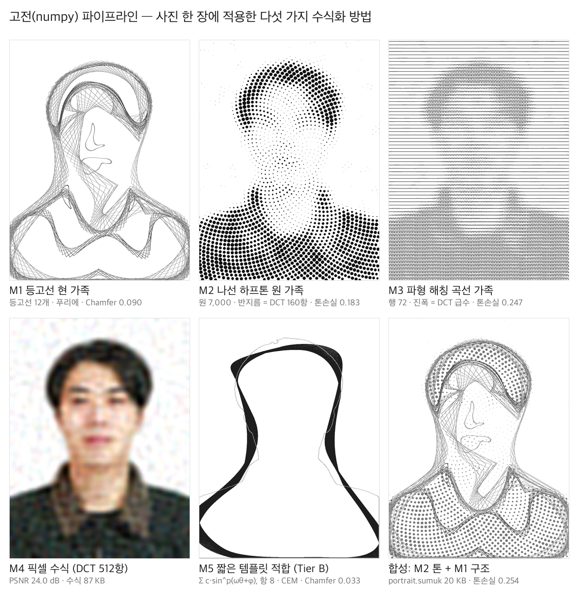
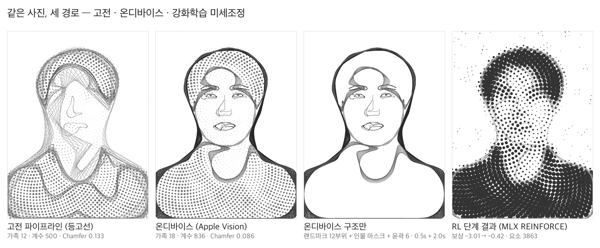
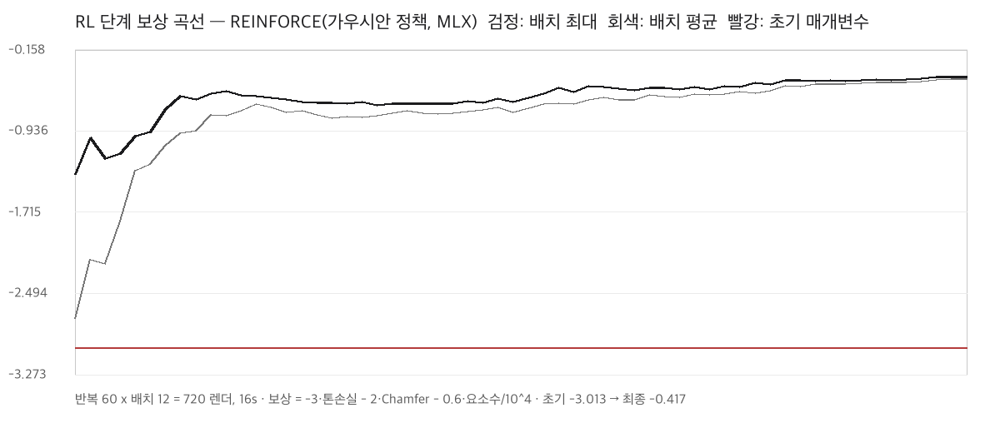

# 초상(肖像) 샘플 보고서 — 사진 한 장을 수식으로

작성일: 2026-10-17
입력: 증명사진 1장(354×472, 흰 배경, 정면 상반신). 원본은 `Media/Portrait/input/`에 두고 **gitignore로 제외**한다. 이 문서와 README의 모든 그림은 사진에서 도출한 수식만으로 다시 그린 것이다.
코드: `Media/src/sumuk_core.py`, `portrait_pipeline.py`, `vision_ondevice.swift`, `portrait_ondevice.py`, `portrait_rl.py`, `make_portrait_figures.py`
결과: `Media/Portrait/out/`(렌더 PNG, `*.sumuk` 수식 전문, `metrics.json`, `ondevice-metrics.json`, `rl-result.json`, `fullres-metrics.json`), README용 그림 `Media/Portrait/portrait-methods.png`, `portrait-compare.png`, `rl-reward-curve.png`

## 1. 목표

PRD의 "그림 → 수식"(FR-5~FR-7)과 새로 추가한 온디바이스 경로(FR-11), RL 미세조정(FR-12)을 Swift로 구현하기 전에, **같은 수학을 Python으로 끝까지 돌려** 어떤 방법이 얼마나 되는지 숫자와 그림으로 확인한다. 모든 방법의 출력은 SuMuk Script(닫힌형 수식)여야 한다.

## 2. 공통 지표

| 지표 | 정의 | 방향 |
| --- | --- | --- |
| 톤 손실 | 렌더와 원본의 가우시안 블러(σ=4px) 명도 차의 평균, 0~1 | 낮을수록 좋음 |
| Chamfer | 렌더 에지 점군 ↔ 원본 에지 점군의 양방향 최근접 평균 거리(캔버스 높이 = 2 기준) | 낮을수록 좋음 |
| PSNR | 픽셀 수식 재구성의 신호 대 잡음비(dB) | 높을수록 좋음 |
| 계수 수 | 푸리에 계수 개수(= 수식 길이의 대리값) | 낮을수록 짧은 수식 |

아래 표의 톤 손실·Chamfer는 전부 **전체 해상도 렌더**에 대해 다시 계산한 값이다(`fullres-metrics.json`).

## 3. 고전(numpy) 경로 — 다섯 가지 방법

| 방법 | 수식 가족 | 핵심 매개변수 | 톤 손실 | Chamfer | 비고 |
| --- | --- | --- | --- | --- | --- |
| M1 등고선 현 가족 | `segments` ×12 | 명도 레벨 5개(0.22~0.86), 등고선 12개, 조화 6~24개, 현 간격 5% | 0.285 | 0.090 | 머리·어깨·옷깃 구조. 푸리에 적합 오차 평균 0.0078 |
| M2 나선 하프톤 | `circles` ×1 (7,000개) | Vogel 나선 s=0.0185, rmax=0.016, γ=1.3, 반지름 = DCT 160항 농담 급수 | **0.183** | 0.102 | 톤 재현 최고. 수식은 나선 한 줄 + D(x,y) 정의 |
| M3 파형 해칭 | `curve` ×72 | 행 72, 진폭 0.011, 주파수 110, 진폭 = D(x,y) | 0.247 | 0.896* | 멀리서 보면 얼굴. 에지가 거의 없어 Chamfer는 의미 없음(*) |
| M4 픽셀 수식 | `pixel` ×1 | 채널별 2D DCT, grid 96×72 | — | — | PSNR 32항 17.7 · 128항 20.6 · 512항 24.0 · 2048항 26.9 dB. 512항 수식 87 KB |
| M5 짧은 템플릿(Tier B) | `segments` ×1 | `x,y = Σ_{j=1..4} c·sign(sin)·|sin|^p(ωθ+φ)`, CEM 40세대×160 | 0.327 | 0.098 | 실루엣 Chamfer 0.033. 1차 푸리에 타원으로 초기화해야 수렴(무작위 초기화는 실패) |
| 합성(M2 톤 + M1 구조) | 13가족 | `portrait.sumuk` 20 KB | 0.254 | 0.134 | README 비교의 "고전" 열 |

관찰
- 톤은 하프톤(M2)이, 구조는 등고선 현(M1)이 맡는 분업이 자연스럽다. M3는 수식이 가장 "수학답지만"(행마다 같은 식) 시각 품질은 낮다.
- 픽셀 수식은 항 수 4배마다 약 3 dB 오른다. 512항이면 얼굴을 알아보지만 수식이 87 KB라 "읽는 수식"으로는 과하다 → 앱 기본값은 128항, 상한 경고 20 KB(PRD FR-7)를 유지.
- Tier B는 실루엣 하나를 8항으로 맞추는 데 9초. 사진 전체를 짧은 식으로 쓰는 것은 여전히 비현실적이고, "가장 큰 윤곽 1개의 요약"에 쓰는 것이 맞다.

## 4. 온디바이스 경로 — Apple Vision

`vision_ondevice.swift`를 이 Mac(M3)에서 컴파일·실행(샌드박스 때문에 `swiftc -module-cache-path /tmp/swiftmc`가 필요했다). 같은 요청이 iOS에서 그대로 동작한다.

| 단계 | API | 시간 |
| --- | --- | --- |
| 얼굴 랜드마크 12부위 | `VNDetectFaceLandmarksRequest` | 0.46 s |
| 인물 세그멘테이션(accurate) | `VNGeneratePersonSegmentationRequest` | 2.00 s |
| 윤곽 검출(≥40점 6개 / 전체 65개) | `VNDetectContoursRequest` | 0.02 s |
| 가족 변환(푸리에·Script) | `portrait_ondevice.py` | 0.24 s |

변환 규칙: 실루엣(마스크 경계, 조화 28) → 현 가족 900개 · 얼굴 윤곽 → 붓 원 가족 · 눈·입 → 작은 현 가족 · 눈썹·코·코능선 → 곡선 · 동공 → 붓 원 · Vision 윤곽 6개 → 옅은 현 가족. 결과 `portrait-ondevice.sumuk` 23 KB.

| 비교 | 가족 수 | 푸리에 계수 | 톤 손실 | Chamfer | 처리 시간 |
| --- | --- | --- | --- | --- | --- |
| 고전 합성(등고선 + 하프톤) | 13 | 500 | 0.254 | 0.134 | 0.7 s |
| 온디바이스 합성(Vision + 같은 하프톤) | 19 | 836 | 0.261 | **0.086** | 2.7 s |
| 온디바이스 구조만 | 18 | 836 | 0.305 | **0.059** | 2.7 s |

결론
- 인물 사진에서는 온디바이스 경로가 **구조(눈·코·입·실루엣)** 를 훨씬 정확히 잡는다(Chamfer 0.134 → 0.086). 톤은 두 경로가 같은 하프톤을 쓰므로 동일하다.
- 비용은 시간(세그멘테이션 2초)과 수식 길이(계수 500 → 836). 앱에서는 세그멘테이션을 `.balanced`로 낮추고, 랜드마크·윤곽만으로 먼저 미리보기를 띄운 뒤 실루엣을 덧붙이는 순서가 맞다.
- 결함: Vision 윤곽(머리카락 경계) 가족이 얼굴을 가로지르는 큰 고리를 그린다. 윤곽끼리 겹치는 영역을 제거하거나 랜드마크 영역 안의 윤곽을 버리는 필터가 필요하다(TASKS T6b.6).
- 비인물 사진에는 랜드마크가 없으므로 "윤곽 + 세그멘테이션 → 가족" 경로만 남고, 둘 다 비면 고전 경로로 폴백한다(FR-11).

## 5. RL 단계 — MLX REINFORCE

문제 설정(FR-12): 합성 작품의 연속 매개변수 7개를 조정해 보상을 최대화한다.

| 매개변수 | 범위 | 초기값 | RL 결과 |
| --- | --- | --- | --- |
| 나선 간격 s | 0.012~0.030 | 0.021 | 0.0246 |
| 최대 점 반지름 rmax | 0.006~0.030 | 0.018 | 0.0298 |
| 감마 γ | 0.6~2.5 | 1.55 | 0.83 |
| 점 개수 N | 1,500~9,000 | 5,250 | 2,310 |
| 현 간격 비율 | 0.01~0.15 | 0.08 | 0.019 |
| 현 먹 농도 | 0~0.8 | 0.40 | 0.79 |
| 톤 먹 농도 | 0.1~1.0 | 0.55 | 0.80 |

- 보상 = −3·톤 손실 − 2·Chamfer − 0.6·(요소 수/10⁴). 렌더는 긴 변 240 px(한 번에 약 20 ms).
- 정책: 시그모이드로 스쿼시한 7차원 가우시안(평균·log σ = 파라미터 14개), REINFORCE + 이동 평균 베이스라인 + 어드밴티지 정규화, Adam(lr 0.05), log σ를 [log 0.05, log 0.8]로 클램프. **클램프가 없으면 σ가 14까지 폭주**해 정책이 수렴하지 않았다(첫 실행에서 확인, 코드에 메모).
- 60반복 × 12샘플 = 720 렌더, 15.7초(Mac M3, Python). 보상 −3.01 → −0.42, 배치 평균도 −2.7 → −0.43으로 수렴(σ 0.68 → 0.22).

전체 해상도에서 다시 잰 전/후:

| | 톤 손실 | Chamfer | 요소 수 |
| --- | --- | --- | --- |
| RL 이전(초기 매개변수) | 0.249 | 0.158 | 6,803 |
| RL 이후 | **0.051** | **0.054** | **3,863** |

해석
- RL은 "점을 크고 진하게, 대신 적게" + "현은 짧고 진하게"를 찾아냈다. 요소 수를 43% 줄이면서 톤·구조 지표를 모두 개선했다 — 길이 패널티 λ가 의도대로 작동한다.
- 주의: 저해상도 환경의 초기 Chamfer(0.95)는 옅은 먹 때문에 에지가 하나도 검출되지 않아 빈 집합 패널티(1.0)에 가깝게 잡힌 값이다. 보상 곡선의 첫 구간 급상승은 그 효과가 크다. 공정한 비교는 위 전체 해상도 표를 보라.
- 결과 이미지는 고대비 하프톤 인물화가 되는데, 이것이 "수묵" 톤과 맞는지는 취향의 문제다. 앱에서는 λ와 보상 가중치를 슬라이더로 노출해 사용자가 스타일을 고르게 한다(FR-12).
- 이 프로토타입은 MLX(Python)다. 앱에서는 정책 파라미터가 14개뿐이므로 MLX Swift 없이도 Accelerate로 같은 업데이트를 손으로 쓸 수 있다. 렌더가 Metal이면 iPhone에서 720 렌더 ≤ 20초는 현실적이다.

## 6. 수식 산출물

| 파일 | 내용 | 크기 |
| --- | --- | --- |
| `out/portrait.sumuk` | 고전 합성: 하프톤 원 가족 1 + 등고선 현 가족 12 + `where` 푸리에 정의 + `D(x,y)` DCT 160항 | 20 KB |
| `out/portrait-ondevice.sumuk` | 온디바이스 합성: 하프톤 + 실루엣·랜드마크·윤곽 가족 18 | 23 KB |
| `out/pixel-T512.sumuk` | 픽셀 수식(RGB 채널별 DCT 512항) | 87 KB |

모든 식은 SuMuk Script 초안 문법(PRD §4)으로 쓰였고, Phase 1 파서가 생기면 이 파일들이 **첫 번째 통합 테스트 픽스처**가 된다.

## 7. 앱 설계에 반영한 것

- PRD FR-11(온디바이스 경로·비교 뷰), FR-12(RL 미세조정) 신설. TASKS Phase 6b 추가.
- 구조/톤 분업: 톤 = 하프톤(고전), 구조 = 온디바이스(가능하면) 또는 등고선. 비교 뷰에서 층을 섞어 저장.
- RL 보상의 λ·가중치는 사용자 슬라이더. log σ 클램프와 "최선 샘플 채택"은 기본 구현.
- 사진 보관은 사용자 동의 시에만(이 샘플처럼 원본을 빼고 수식만 남기는 것이 기본값).

## 8. 남은 문제

- Vision 윤곽 가족의 얼굴 가로지르기(§4 결함).
- M3 파형 해칭은 진폭·주파수를 RL 대상에 넣지 않았다. 넣으면 세 층(하프톤·현·파형) 조합이 가능하다.
- Tier B(M5)를 얼굴 부위별(눈·입)로 확장하면 "짧은 식의 초상"이 가능할지 미확인.
- 사람 아닌 사진(풍경·사물)으로 같은 파이프라인을 돌린 결과가 없다 — 다음 샘플 후보.
