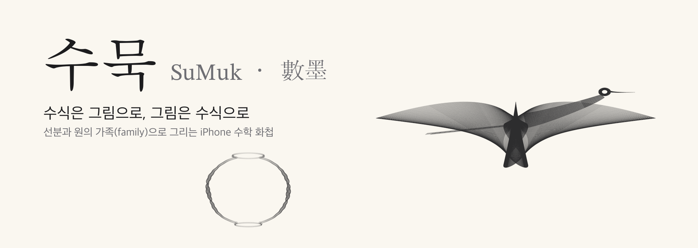
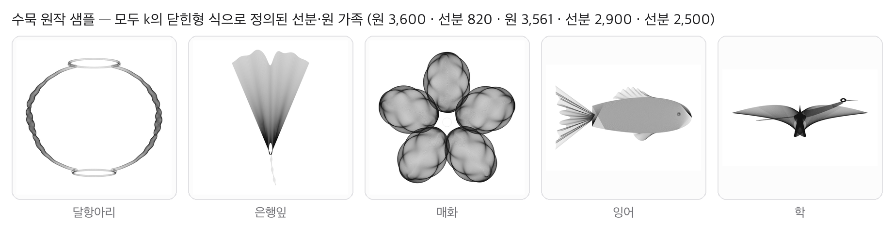
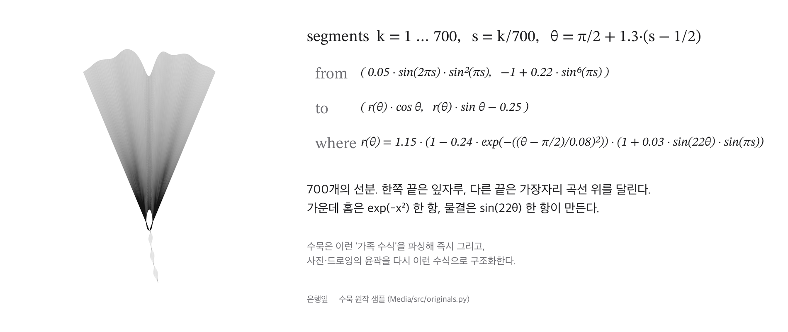
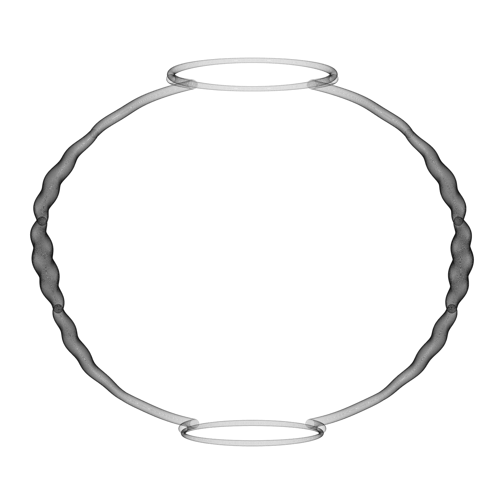
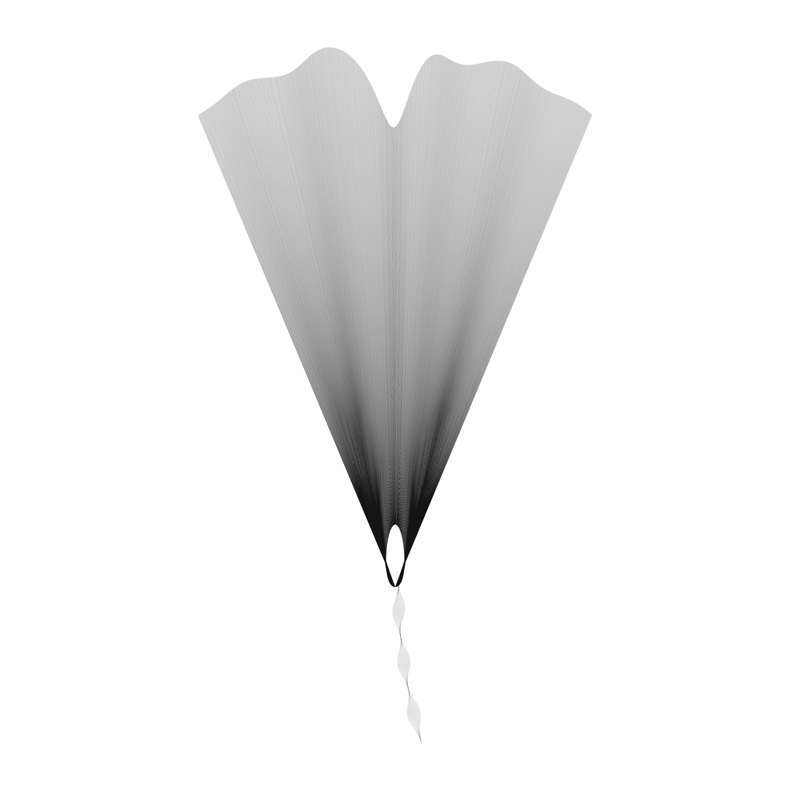
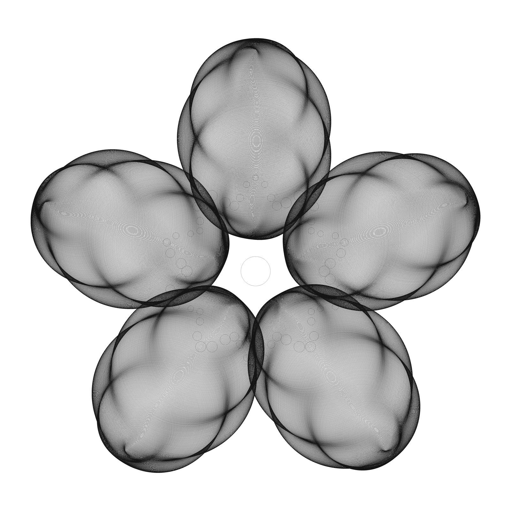
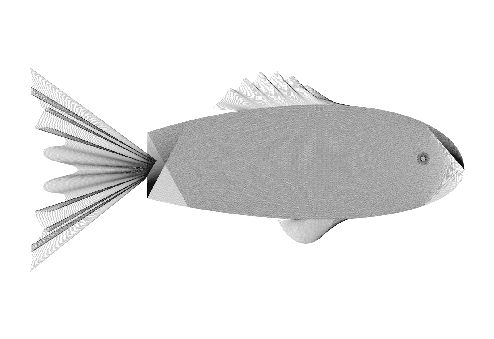
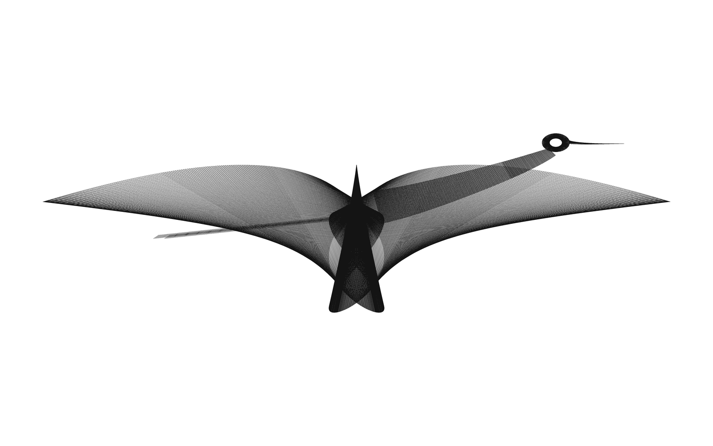
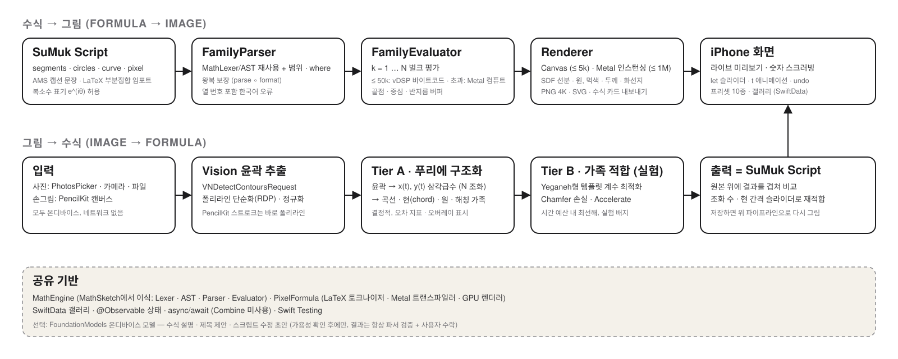

<div align="center">



# 수묵 (SuMuk · 數墨)

**수식을 넣으면 그림이 되고, 내 그림·사진을 넣으면 그것을 이루는 수식이 되는 iPhone 앱**


<br/>



<sub>이 저장소의 모든 이미지는 외부에서 가져온 것이 없다. 전부 <code>Media/src</code>의 Python 생성기가 이 프로젝트에서 설계한 수식만으로 그린 것이다.</sub>

</div>

## 목차

- [소개](#소개)
- [가족 수식이란](#가족-수식이란)
- [핵심 기능](#핵심-기능)
- [샘플 갤러리](#샘플-갤러리)
- [SuMuk Script 맛보기](#sumuk-script-맛보기)
- [파이프라인과 아키텍처](#파이프라인과-아키텍처)
- [문서와 진행 상황](#문서와-진행-상황)
- [샘플 이미지 다시 만들기](#샘플-이미지-다시-만들기)
- [영감과 참고](#영감과-참고)
- [라이선스](#라이선스)

## 소개

삼각함수로 끝점을 정한 선분 수백 개를 포개면, 직선들의 **포락선(envelope)** 이 곡선처럼 보인다. 원의 반지름을 변조하면 먹의 농담이 된다. 이 두 가지 단순한 원리만으로 새, 꽃, 항아리를 그릴 수 있다는 것이 수학 미술가 Hamid Naderi Yeganeh가 보여 준 발견이다.

**수묵(數墨)** 은 이 원리를 iPhone에서 두 방향으로 쓴다.

- **수식 → 그림**: 선분·원 가족 수식을 붙여넣거나 직접 쓰면 즉시 그려진다. 숫자를 손가락으로 문질러 바꾸면 그림이 실시간으로 따라 변한다. 1,000,000개 선분도 Metal로 1초 안에.
- **그림 → 수식**: 손으로 그린 드로잉(PencilKit), 앱 안에서 만든 그림, 사진 라이브러리의 사진을 가져오면, Vision으로 윤곽을 뽑고 **푸리에 급수 → 선분/원 가족**으로 구조화해 **다시 파싱 가능한 수식**으로 돌려준다. 결과는 원본 위에 겹쳐 오차와 함께 보인다.

[MathSketch](https://github.com/kimminung/MathSketch)가 "도형 23종을 조립해 하나의 합성 수식으로"였다면, 수묵은 **"짧은 수식 하나에서 수천 개의 선분과 원이 태어나는"** 방식을 1급 시민으로 삼는다. MathSketch의 MathEngine(렉서·파서·평가기)과 픽셀 수식 모드(LaTeX → Metal GPU)를 그대로 이식해 출발한다.

> 현재 상태(2026-10-17): 기술 PRD·태스크 문서·샘플 이미지까지 완료된 **설계 단계**다. Xcode 구현은 [Docs/TASKS-SuMuk.md](Docs/TASKS-SuMuk.md)의 Phase 0 T0.4부터 시작한다.

## 가족 수식이란



- **선분 가족** — `k = 1 … N`마다 끝점 `(x₁(k), y₁(k))`, `(x₂(k), y₂(k))`를 정의한 N개의 선분. 위 은행잎은 선분 700개와 잎자루 120개뿐이다.
- **원 가족** — `k`마다 중심 `(X(k), Y(k))`와 반지름 `R(k)`를 정의한 N개의 원. 반지름 변조가 붓 압력과 농담을 만든다(달항아리).
- **픽셀 수식** — 픽셀 `(m, n)`의 색을 직접 계산하는 함수망. MathSketch에서 구현한 LaTeX 부분집합 파서와 Metal 렌더러를 이식한다.

## 핵심 기능

- **SuMuk Script** — 선분·원·곡선·픽셀 가족을 쓰는 작은 DSL. 영어 캡션 문장("For each k = 1, …, N the endpoints of the k-th line segment are …")과 LaTeX(`\sin^7`, `\frac`)도 관대하게 임포트하고, **복소수 표기**(`(cos a − i·cos b)·e^(iφ)`)도 그대로 받는다.
- **라이브 편집** — 120ms 디바운스 파싱, 숫자 **스크러빙**(길게 누르고 좌우로), `let` 변수 슬라이더, `t` 변수 애니메이션. 스크립트 텍스트가 유일한 진실이라 되돌리기·저장·공유가 한 경로다.
- **대형 렌더** — 요소 5,000개까지는 SwiftUI `Canvas`, 그 이상은 Metal 컴퓨트(식 → 셰이더 트랜스파일) + 인스턴스드 SDF 렌더. 100,000개 원 16ms, 1,000,000개 선분 1초 미리보기 목표.
- **그림 → 수식 Tier A(결정적)** — Vision 윤곽 → 호 길이 재매개변수화 → 푸리에 급수 `x(t), y(t)` → 네 가지 가족으로 변환: 곡선 / **현(chord) 가족**(곡선 위 점 `A(k)`와 `A(k+δ)`를 잇는 스트링 아트) / **원 가족**(붓 윤곽) / **해칭 가족**(내부 채움). 조화 수와 현 간격 슬라이더로 즉시 재적합, 오차 지표와 오버레이.
- **그림 → 수식 Tier B(실험)** — 짧은 삼각함수 템플릿(`Σ cⱼ·sin^{pⱼ}(ωⱼθ + φⱼ)`)의 계수를 Chamfer 손실로 최적화해 "긴 푸리에" 대신 "짧은 수식"을 시도. 시간 예산·진행률·실험 배지와 함께.
- **픽셀 수식 양방향** — LaTeX 픽셀 수식 → GPU 이미지(이식), 사진 → 절단 2D DCT 급수 픽셀 수식(항 수 조절, PSNR 표시, 왕복 렌더 일치 보장).
- **갤러리·공유** — SwiftData 갤러리(스크립트 원문 저장), PNG 4K·SVG·수식 카드·LaTeX 내보내기. 모두 **온디바이스**, 네트워크 없음.
- **선택: FoundationModels 보조** — 가용할 때만, 수식 설명·제목 제안·자연어 수정 초안. 모델 출력은 항상 파서 검증과 사용자 수락을 거친다.

## 샘플 갤러리

번들 프리셋 5종. 모두 이 프로젝트에서 설계한 원작이며, 각 작품은 가족 2~6개의 합성이고 모든 좌표는 `k`의 닫힌형 식이다. 수식은 `Media/src/originals.py`에 있다.

<div align="center">



</div>
<p align="center"><sub>달항아리 — 원 3,600개, 중심이 항아리 윤곽(초타원 프로파일)을 따라 움직이고 반지름이 붓 압력 · 은행잎 — 잎자루에서 물결치는 가장자리로 펼쳐지는 선분 820개 · 매화 — 꽃잎 5장 × 원 700개 + 수술 60개</sub></p>

<div align="center">


</div>
<p align="center"><sub>잉어 — 서로 교차하는 두 해칭 가족(몸통) + 부채꼴 꼬리·지느러미 + 눈(작은 원의 현) 선분 2,900개 · 학 — 날개 가족(sin⁷ 포락선) + S자 목·머리·부리·다리 선분 2,500개</sub></p>

## SuMuk Script 맛보기

```
// 은행잎 (수묵 원작) — 잎자루에서 가장자리로 펼쳐지는 부채
let notch = 0.24 in [0, 0.5]
segments k = 1 ... 700 {
  from ( 0.05 · sin(2πs(k)) · sin^2(πs(k)),  −1 + 0.22 · sin^6(πs(k)) )
  to   ( r(k) · cos θ(k),  r(k) · sin θ(k) − 0.25 )
}
where
  s(k) = k/700
  θ(k) = π/2 + 1.3 · (s(k) − 1/2)
  r(k) = 1.15 · (1 − notch · exp(−((θ(k) − π/2)/0.08)^2)) · (1 + 0.03 · sin(22θ(k)) · sin(πs(k)))
```

```
// 달항아리 (수묵 원작) — 원의 중심은 항아리 윤곽, 반지름은 붓 압력
let brush = 0.03 in [0.01, 0.08]
circles k = 1 ... 1800 {
  center ( −r(k) + 0.02·sin^2(πu(k))·sin(2πu(k)),  −0.86 + 1.72·u(k) )
  radius  0.022 + brush·sin^1.5(πu(k))·|cos(4πu(k) + 0.4)|^0.6
}
where
  u(k) = k/1800
  y(k) = −0.86 + 1.72·u(k)
  r(k) = max( 0.98·(1 − |y(k)/0.86|^2.4)^(1/2.1)·(1 + 0.06·exp(−((y(k)−0.15)/0.35)^2)),
              0.34·exp(−(u(k)/0.035)^2),  0.40·exp(−((u(k)−1)/0.03)^2) )
```

```
// 그림 → 수식 결과 예 (현 가족): 윤곽의 푸리에 곡선 위 점 A(k)와 A(k+δ)를 잇는다
let δ = 37 in [1, 200]
segments k = 1 ... 600 {
  from ( x(2πk/600), y(2πk/600) )
  to   ( x(2π(k+δ)/600), y(2π(k+δ)/600) )
}
where
  x(t) = 0.012 + 0.731·cos(t) − 0.044·sin(t) + 0.118·cos(2t) + …   // 조화 16개
  y(t) = …
```

## 파이프라인과 아키텍처



```
SuMuk/
  MathEngine/        # MathSketch 이식: Lexer · AST · Parser · Evaluator
    PixelFormula/     # LaTeX 토크나이저 · 파서 · CPU 평가기 · Metal 트랜스파일러 · GPU 렌더러
  Script/            # SuMuk Script 렉서·FamilyParser·Formatter·캡션/LaTeX 임포터
  Family/            # Artwork · Family · 바이트코드 컴파일러 · vDSP/Metal 평가기
  Render/            # FitContext · Canvas 렌더러 · Metal 인스턴싱 SDF 렌더러 · 내보내기
  Structuring/       # 그림→수식: Vision 윤곽 · PencilKit 스트로크 · 푸리에 · 가족 합성 4종 · Tier B 적합 · DCT 픽셀
  Presets/           # Presets.json (원작 5종 + 사용자 저장)
  Assistant/         # FoundationModels 보조(가용성 게이트)
  Model/  Persistence/  Views/  Resources/
SuMukTests/          # Swift Testing
Docs/                # PRD · TASKS
Media/               # banner · samples-grid · formula-card · pipeline.svg · Samples/ · src/(Python 생성기)
```

상태는 `@Observable`, 비동기는 async/await(`Task` 디바운스, Combine 미사용), 무거운 계산은 `nonisolated` 순수 함수로 분리한다. 자세한 요구사항은 [Docs/PRD-SuMuk.md](Docs/PRD-SuMuk.md).

## 문서와 진행 상황

| 문서 | 내용 |
| --- | --- |
| [Docs/PRD-SuMuk.md](Docs/PRD-SuMuk.md) | 비전·목표·시나리오, SuMuk Script 문법, FR-1~FR-10, 비기능 요구사항, 아키텍처, 영감·출처, 리스크 |
| [Docs/TASKS-SuMuk.md](Docs/TASKS-SuMuk.md) | Phase 0~12 태스크(체크박스), 수용 기준, 설계 메모 |

| Phase | 상태 |
| --- | --- |
| 0 셋업·문서·샘플 | 문서·샘플 완료, Xcode 프로젝트 개명·이동(T0.4~) 대기 |
| 1 파서 · 2 평가/Canvas/프리셋 · 3 에디터 | 미착수 |
| 4 Metal · 5 그림→수식 Tier A · 6 Tier B | 미착수 |
| 7 픽셀 수식 · 8 갤러리 · 9 FoundationModels · 10 접근성 · 11 검증/공개 | 미착수 |

## 샘플 이미지 다시 만들기

Python 3.9 이상과 numpy, Pillow만 있으면 된다(macOS 기본 Python에 둘 다 들어 있다).

```
cd Media/src
python3 originals.py             # 수묵 원작 5종 → ../Samples/sumuk-*.png
python3 make_readme_images.py    # banner.png · samples-grid.png · formula-card.png
```

렌더러(`render_samples.py`)는 4배 슈퍼샘플링 후 LANCZOS 축소로 가는 선을 살린다. 앱의 Swift 파서가 생기면 이 Python 생성기는 **테스트 픽스처 생성기**(특정 k에서의 끝점 좌표)로 역할이 바뀐다(TASKS T1.7).

## 영감과 참고

- Hamid Naderi Yeganeh, *Mathematical Concepts Illustrated by Hamid Naderi Yeganeh*, [AMS Mathematical Imagery](https://www.ams.org/publicoutreach/math-imagery/yeganeh) — 선분 가족·원 가족으로 실물을 그리는 기법의 원천. 이 저장소는 그의 이미지나 공식을 포함하지 않으며, **기법만** 응용해 모든 샘플을 새로 설계했다.
- 참고 프로젝트 [MathSketch](https://github.com/kimminung/MathSketch) — MathEngine, 픽셀 수식 모드(LaTeX → Metal), `FitContext`, SwiftData 패턴.

## 라이선스

Apache 2.0 — [LICENSE](LICENSE) 참고. 수묵 원작 샘플 5종(달항아리·은행잎·매화·잉어·학)의 수식과 생성기도 같은 라이선스다.
